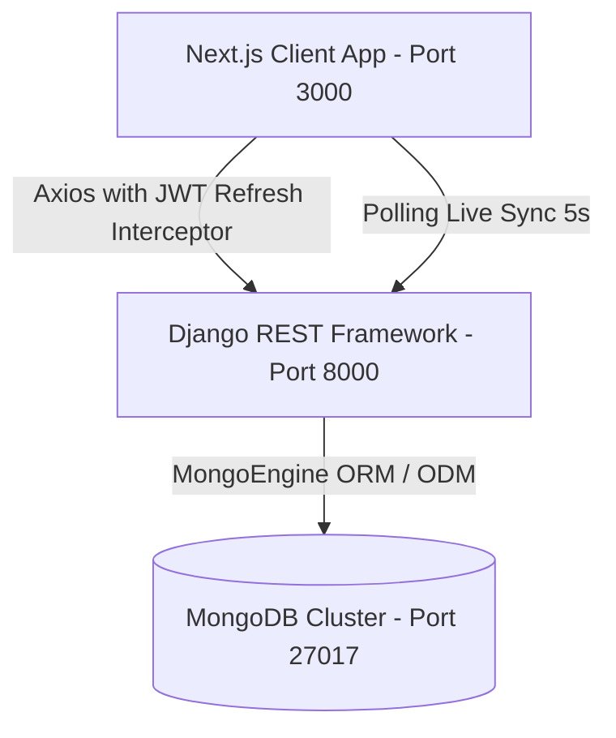

# 🚀 Team Task Tracker Tool: Team Task Tracker with Role-Based Permissions & Activity Timeline

A production-grade mini Team Task Tracker built from scratch using **Django REST Framework + MongoDB (MongoEngine)** on the backend and **Next.js (App Router) + TailwindCSS** on the frontend, featuring real-time activity timelines, role-based authorization (Admin & Member), and JWT refresh token rotation.

---

## 📋 Table of Contents
- [Architecture Overview](#-architecture-overview)
- [Feature Highlights & Requirements Checklist](#-feature-highlights--requirements-checklist)
- [Tech Stack](#-tech-stack)
- [Pre-Seeded Demo Accounts](#-pre-seeded-demo-accounts)
- [REST API Reference](#-rest-api-reference)
- [Local Development Setup](#-local-development-setup)
- [Running Automated Tests](#-running-automated-tests)
- [Docker Production Deployment](#-docker-production-deployment)
- [Security & Architecture Decisions](#-security--architecture-decisions)

---

## 🏛 Architecture Overview



---

## ✨ Feature Highlights & Requirements Checklist

| Requirement | Implementation Status | Description |
| :--- | :---: | :--- |
| **User Registration & Login** | ✅ Completed | JWT-based auth with PBKDF2-SHA256 password hashing. |
| **Role-Based Permissions** | ✅ Completed | Strict `Admin` vs `Member` roles. Only Admins can create teams or invite members. |
| **Team Management** | ✅ Completed | Team creation, members listing, member removal. |
| **Member Invitations** | ✅ Completed | Admins can invite existing users or simulate invitations for new email addresses. |
| **Task Management** | ✅ Completed | Tasks with title, description, assignee, status (`Pending`, `In Progress`, `Done`). Team-isolated. |
| **Activity Timeline** | ✅ Completed | Chronological timeline tracking creations, status changes, assignments, comments, and invitations. |
| **Task Comments (Bonus)** | ✅ Completed | Comment threads with author, timestamp, and instant timeline log generation. |
| **Status Filters (Bonus)** | ✅ Completed | Filter tasks by `All`, `Pending`, `In Progress`, `Done` + search queries. |
| **JWT Refresh Tokens (Bonus)**| ✅ Completed | Short-lived access token + 7-day refresh token with automatic client-side retry interceptor. |
| **TailwindCSS UI (Bonus)** | ✅ Completed | Modern dark-mode aesthetic with glassmorphism and micro-interactions. |
| **Live Timeline Updates** | ✅ Completed | Auto-polling (5s) with live indicator toggle and instant optimistic UI. |
| **Full Deployment** | ✅ Completed | Standalone Dockerfiles and `docker-compose.yml` for multi-container orchestration. |

---

## 🛠 Tech Stack

- **Backend**:
  - Python 3.12 / 3.13
  - Django & Django REST Framework (DRF)
  - `mongoengine` & `pymongo` (NoSQL Document Object Mapping)
  - `pyjwt` (HS256 JSON Web Tokens)
  - `django-cors-headers`
  - `gunicorn` (Production WSGI)
- **Frontend**:
  - Next.js 16 (App Router)
  - React 19
  - TailwindCSS
  - `axios` (with custom token refresh interceptors)
  - `lucide-react` (Modern icon suite)
- **Database**:
  - MongoDB 7.0 (with compound indexes on teams, tasks, and activities)

---

## 👤 Pre-Seeded Demo Accounts

The database comes pre-seeded with sample teams, tasks, comments, and activities:

| Name | Email | Password | Role | Access Level |
| :--- | :--- | :--- | :--- | :--- |
| **Saumyakanta** | `admin@tasktracker.io` | `Password123!` | `Admin` | Full management: create teams, invite members, edit/delete tasks |
| **Alice Chen** | `alice@tasktracker.io` | `Password123!` | `Member` | Collaborate on tasks, comment, update status |
| **David Miller** | `david@tasktracker.io` | `Password123!` | `Member` | Collaborate on tasks, comment, update status |
| **Sophia Patel** | `sophia@tasktracker.io` | `Password123!` | `Member` | Collaborate on tasks, comment, update status |

> **Tip**: The login page includes 1-click quick-fill buttons for both Admin and Member credentials.

---

## 🔌 REST API Reference

### Authentication (`/api/auth/`)
- `POST /api/auth/register/` - Register new user with `name`, `email`, `password`, `role` (`Admin` or `Member`).
- `POST /api/auth/login/` - Authenticate user; returns `user` object, `access` token (60m), and `refresh` token (7d).
- `POST /api/auth/refresh/` - Refresh expired access token using valid `refresh` token.
- `GET /api/auth/me/` - Retrieve current authenticated user profile.
- `GET /api/auth/users/` - Search/list users for assigning or inviting.

### Teams (`/api/teams/`)
- `GET /api/teams/` - List all teams where the current user is a member or creator.
- `POST /api/teams/` - **Admin only**: Create a new team with `name` and `description`.
- `GET /api/teams/<team_id>/` - Retrieve team details and member list (Team members only).
- `PATCH /api/teams/<team_id>/` - **Admin only**: Update team details.
- `DELETE /api/teams/<team_id>/` - **Admin only**: Delete team.
- `POST /api/teams/<team_id>/invite/` - **Admin only**: Invite a member by email (simulates invitation if email does not yet exist).
- `DELETE /api/teams/<team_id>/members/<user_id>/` - **Admin only**: Remove a member from the team.

### Tasks (`/api/`)
- `GET /api/teams/<team_id>/tasks/` - List tasks for team. Supports query filters: `?status=In Progress`, `?search=term`, `?assigned_to=me`.
- `POST /api/teams/<team_id>/tasks/` - Create a task in the team with `title`, `description`, `status`, `assigned_to`. Logs activity.
- `GET /api/tasks/<task_id>/` - Retrieve task details and comments.
- `PATCH /api/tasks/<task_id>/` - Update title, description, status, or assignee. Logs status/assignment changes to timeline.
- `DELETE /api/tasks/<task_id>/` - Delete task. Logs activity.
- `POST /api/tasks/<task_id>/comments/` - Add a comment to task with `text`. Logs activity to team timeline.

### Activity Timeline (`/api/`)
- `GET /api/teams/<team_id>/timeline/` - Retrieve chronological activity entries for the team, ordered most recent first (`-created_at`).

---

## 💻 Local Development Setup

### 1. Prerequisites
- Python 3.11+
- Node.js 18+ and npm
- MongoDB Server running locally on port 27017

### 2. Backend Setup
```bash
# Navigate to backend
cd backend

# Create and activate virtual environment
python -m venv venv
# Windows:
venv\Scripts\activate
# Linux/macOS:
source venv/bin/activate

# Install dependencies
pip install -r requirements.txt

# Seed sample database
python seed_data.py

# Start Django development server
python manage.py runserver 127.0.0.1:8000
```
Backend will be live at `http://127.0.0.1:8000`.

### 3. Frontend Setup
```bash
# In a new terminal, navigate to frontend
cd frontend

# Install dependencies
npm install

# Start Next.js development server
npm run dev
```
Frontend will be live at `http://localhost:3000`.

---

## 🧪 Running Automated Tests

Run the automated test suite verifying auth, role permissions, task mutations, and activity timeline generation:
```bash
cd backend
python manage.py test tests_api
```

---

## 🐳 Docker Production Deployment

To run the complete production stack (MongoDB + Django API + Next.js App) with a single command:

```bash
docker compose up --build -d
```

### Access Services:
- **Next.js Web App**: `http://localhost:3000`
- **Django REST API**: `http://localhost:8000/api/health/`
- **MongoDB**: `localhost:27017`

To shut down:
```bash
docker compose down
```
