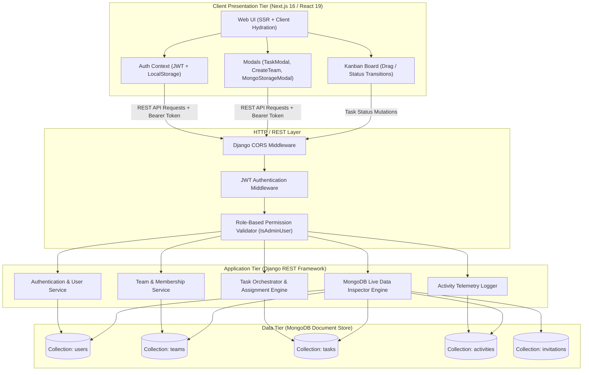
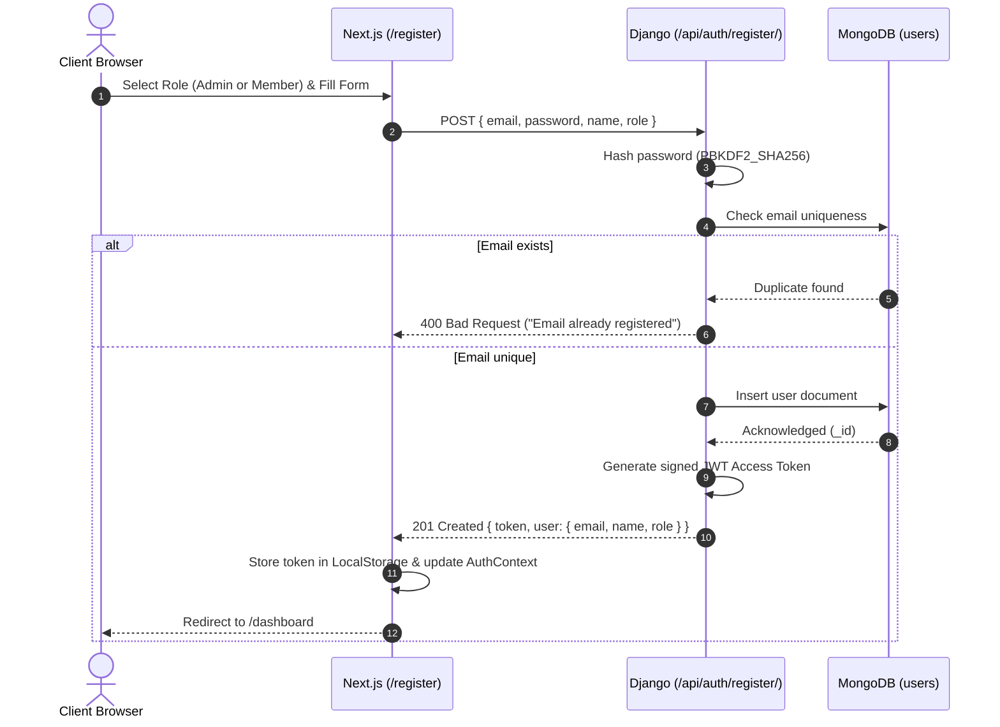
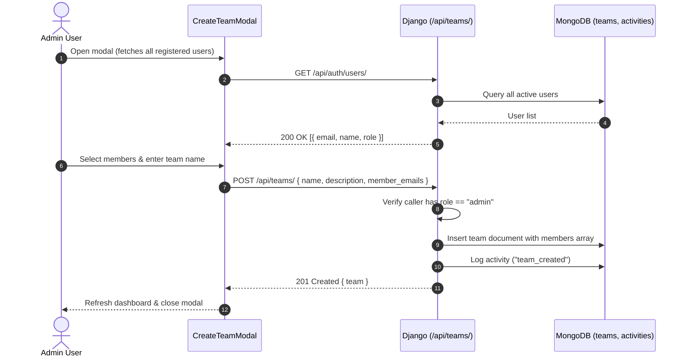
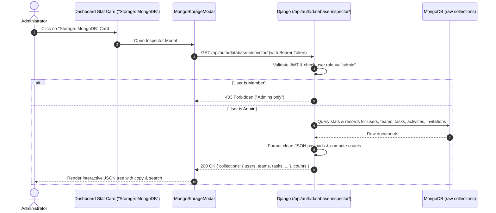

# 🏛️ System Design & Architecture Specification
## Team Task Tracker (PulseSync)

> **Document Version:** 1.0.0  
> **Target Audience:** Software Architects, Engineering Leads, Full-Stack Developers  
> **Author:** Antigravity Engineering Team  

---

## 1. Executive Summary & Problem Context

**Team Task Tracker (PulseSync)** is an enterprise-grade collaborative project and task management system inspired by Atlassian Jira and Linear. It provides teams with a streamlined workspace to manage projects, assign work across distributed teams, visualize task lifecycles on Kanban boards, track detailed audit timelines, and inspect underlying database states in real time.

The system is architected around **strict Role-Based Access Control (RBAC)**, **asynchronous client-server communication**, and **document-oriented persistence** via MongoDB.

---

## 2. High-Level Architecture

The platform adheres to a modern **Decoupled 3-Tier Architecture**:

1. **Client Tier (Presentation Layer):** Next.js 16 (React 19, App Router) with TailwindCSS v4 and Lucide icons.
2. **Application Tier (Business Logic Layer):** Python / Django REST Framework (DRF) handling authentication, permission enforcement, team orchestration, and activity telemetry.
3. **Data Tier (Persistence Layer):** MongoDB document database operating on Port 27017 (or MongoDB Atlas) for high-write task mutations and flexible JSON querying.

### Architectural Diagram



---

## 3. Technology Stack & Design Decisions

| Layer | Technology | Version | Rationale & Trade-offs |
| :--- | :--- | :--- | :--- |
| **Frontend** | Next.js / React | 16.4.2 / React 19 | Server-Side Rendering (SSR) for fast initial loads; Client components for reactive Kanban interactions and live modals. |
| **Styling** | TailwindCSS | v4.0 | Modern utility-first CSS, zero runtime overhead, dynamic theme variables, sleek dark-mode aesthetics. |
| **Backend API** | Django REST Framework | 6.1.2 (Django) / 3.18 (DRF) | Robust enterprise-grade framework with mature serializer pipeline, declarative permissions, and secure request sanitization. |
| **Authentication** | JWT (PyJWT) | 2.15.1 | Stateless authentication with cryptographic signature verification; eliminates server-side session memory overhead. |
| **Database** | MongoDB / PyMongo | 7.0 / PyMongo 4.19 | Document model naturally accommodates nested task metadata, dynamic team member lists, and unstructured activity logs without rigid migration locks. |
| **Environment Management** | Python venv & start.bat | - | Self-healing 1-click startup script that checks and provisions Python venvs and node dependencies automatically. |

---

## 4. Database Schema & Data Models (MongoDB Collections)

All documents are stored within the `tasktracker_db` database.

### 4.1 `users` Collection
Represents registered platform members and administrators.

```json
{
  "_id": "ObjectId('67139...')",
  "email": "user@example.com",
  "password": "pbkdf2_sha256$260000$...",
  "name": "Jane Doe",
  "role": "admin", // Enum: "admin" | "member"
  "organization": "PulseSync Engineering",
  "is_active": true,
  "created_at": "2026-10-19T06:00:00Z",
  "last_login": "2026-10-19T13:45:00Z"
}
```
* **Indexes:** Unique index on `email`.

### 4.2 `teams` Collection
Represents collaborative workspaces created by Administrators.

```json
{
  "_id": "ObjectId('6713a...')",
  "name": "Frontend Core",
  "description": "Design system and client portal development",
  "owner_email": "admin@teamtracker.local",
  "members": [
    "admin@teamtracker.local",
    "alice.chen@techcorp.io",
    "bob.smith@techcorp.io"
  ],
  "admins": [
    "admin@teamtracker.local"
  ],
  "created_at": "2026-10-19T06:15:00Z"
}
```
* **Indexes:** Index on `owner_email`, multikey index on `members`.

### 4.3 `tasks` Collection
Represents actionable units of work tracked across workflow states.

```json
{
  "_id": "ObjectId('6713b...')",
  "title": "Build MongoDB Live Inspector Modal",
  "description": "Expose JSON view of collections to admin dashboard",
  "team_id": "6713a...",
  "creator_email": "admin@teamtracker.local",
  "assignee_email": "alice.chen@techcorp.io",
  "status": "in_progress", // Enum: "todo" | "in_progress" | "in_review" | "done"
  "priority": "high",       // Enum: "low" | "medium" | "high" | "urgent"
  "due_date": "2026-10-25T00:00:00Z",
  "created_at": "2026-10-19T08:00:00Z",
  "updated_at": "2026-10-19T13:20:00Z"
}
```
* **Indexes:** Compound index on `{ team_id: 1, status: 1 }`, index on `assignee_email`.

### 4.4 `activities` Collection
Audit log preserving chronological timeline events for security and transparency.

```json
{
  "_id": "ObjectId('6713c...')",
  "action_type": "status_changed", // "created", "assigned", "status_changed", "member_joined"
  "user_email": "alice.chen@techcorp.io",
  "user_name": "Alice Chen",
  "task_id": "6713b...",
  "task_title": "Build MongoDB Live Inspector Modal",
  "team_id": "6713a...",
  "team_name": "Frontend Core",
  "details": "Changed status from To Do to In Progress",
  "timestamp": "2026-10-19T13:20:00Z"
}
```
* **Indexes:** Descending index on `timestamp`, index on `team_id`.

---

## 5. Security & Role-Based Access Control (RBAC) Matrix

PulseSync enforces role permissions at both the UI router level and backend API decorator/permission level:

| Feature / Action | API Endpoint | Administrator (`admin`) | Member (`member`) |
| :--- | :--- | :---: | :---: |
| **Registration Role Selection** | `POST /api/auth/register/` | Permitted | Permitted |
| **Sign In & JWT Issuance** | `POST /api/auth/login/` | Permitted | Permitted |
| **View Dashboard Overview** | `GET /api/teams/` & `/api/tasks/` | Full System View | Assigned Tasks & Teams |
| **Live MongoDB Data Inspector** | `GET /api/auth/database-inspector/` | **Allowed** | **Forbidden (403)** |
| **Create New Team** | `POST /api/teams/` | **Allowed** | **Forbidden (403)** |
| **Direct Add Member to Team** | `POST /api/teams/<id>/add-members/` | **Allowed** | **Forbidden (403)** |
| **Send Email Invitation** | `POST /api/teams/<id>/invite/` | **Allowed** | **Forbidden (403)** |
| **Create Task** | `POST /api/tasks/` | **Allowed** | **Forbidden (403)** |
| **Assign Task (Any User)** | `POST /api/tasks/` & `PUT` | **Allowed** | **Forbidden (403)** |
| **Update Task Status** | `PATCH /api/tasks/<id>/status/` | Allowed | **Allowed** |
| **User Directory Management** | `GET /api/auth/users/` | **Allowed** | **Forbidden (403)** |
| **Audit Activity Log** | `GET /api/activity/` | Full System Audit | Team Specific Audit |

---

## 6. End-to-End System Flows

### 6.1 User Registration & Role Selection Flow


### 6.2 Team Creation with Immediate Member Assignment


### 6.3 Live MongoDB Data Inspector Flow


---

## 7. Key Architectural Trade-offs & Decisions

### 7.1 MongoDB vs. Traditional Relational Database (PostgreSQL)
* **Decision:** Used MongoDB as the primary document store.
* **Pros:** Highly flexible schemas for tasks and team memberships; array manipulation (`$addToSet`, `$push`) makes managing members and nested assignees effortless; rapid JSON serialization directly into REST payloads.
* **Trade-off:** No native cross-collection foreign key constraints; integrity is enforced at the Django application and serializer layers.

### 7.2 Stateless JWT vs. Server-Side Sessions
* **Decision:** Stateless JSON Web Tokens stored on the client.
* **Pros:** Horizontally scalable; backend servers require zero shared session cache (e.g. Redis) for request validation; faster response times.
* **Trade-off:** Token revocation before expiration requires token blacklisting; mitigated by short access token lifetimes.

### 7.3 1-Click Startup Automation (`start.bat` / `start.sh`)
* **Decision:** Automated launcher scripts rather than forcing Docker-only or manual multi-command workflows.
* **Pros:** Zero-friction onboarding for new developers; auto-creates Python virtual environments on the local machine without platform-specific binary crashes or absolute path corruption.
* **Trade-off:** Host machine must have Python, Node.js, and MongoDB installed.

---

## 8. Scalability & Production Readiness Recommendations

1. **Horizontal Backend Scaling:** Deploy Django behind a Gunicorn WSGI cluster managed by Nginx or AWS ECS.
2. **Database Clustering:** Use MongoDB Atlas Replica Sets with read preference set to `secondaryPreferred` for read-heavy operations like activity feeds and timeline logs.
3. **Caching Layer:** Introduce Redis caching for `/api/auth/users/` and `/api/teams/` queries to minimize repeated database round-trips.
4. **WebSocket Push Notifications:** Upgrade polling-based timelines to Django Channels or Next.js Server-Sent Events (SSE) for real-time multiplayer updates across team boards.
